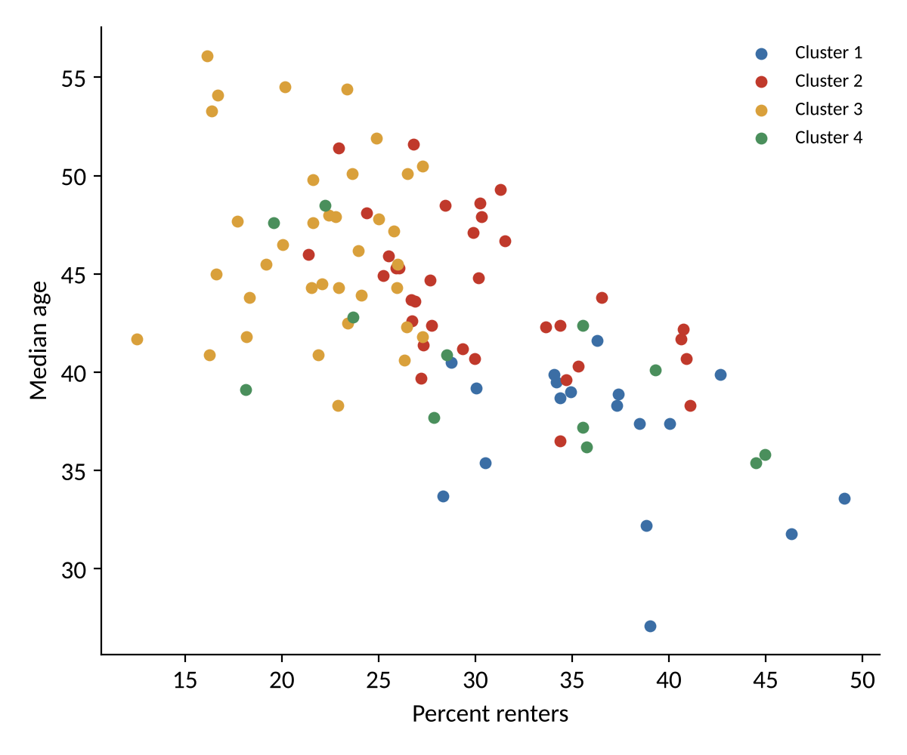
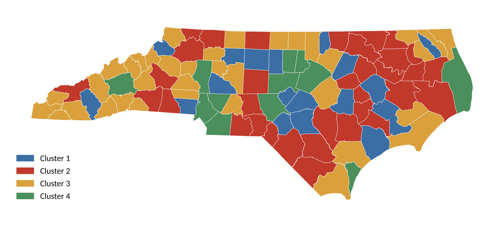

## Overview

The models in the Spatial Modeling reading (OLS, the spatial lag model, and the spatial error model) are all **global models**. They estimate one set of coefficients for the entire study area, which assumes that the relationship between each variable and the outcome is the same everywhere. As discussed in the Introduction to Space reading, this is often not true. Spatial processes are frequently **non-stationary**, meaning that the way a process operates can change across space.

This chapter introduces two approaches that move beyond a single global description of the data. **Geographically weighted regression (GWR)** allows the relationships in a regression model to vary across space. **Geodemographic clustering** uses many variables at once to group places into types of neighborhoods with similar characteristics.

## Geographically Weighted Regression (GWR)

### From Global to Local

In an OLS regression, the model is:

$$
y_i = \beta_0 + \sum_{k} \beta_k x_{ik} + \epsilon_i
$$

Each coefficient (βₖ) is a single value that applies to every location. GWR instead estimates a separate regression at each location i, so that every coefficient can take a different value at every location:

$$
y_i = \beta_0(u_i, v_i) + \sum_{k} \beta_k(u_i, v_i) x_{ik} + \epsilon_i
$$

where:

- (uᵢ, vᵢ) = coordinates of location i
- βₖ(uᵢ, vᵢ) = the coefficient for variable k at location i

To estimate the regression at each location, GWR uses the observations around that location and gives more **weight** to observations that are closer (this is Tobler's First Law built directly into the model). In other words, a GWR is a set of many local regressions, each one centered on a different location and each one using a weighted set of nearby observations.

### Kernels and Bandwidth

The weights in a GWR are defined by a **kernel**, which is a function that decreases the weight of an observation as distance from the regression point increases. Two of the most common kernels are the Gaussian kernel, where weights decrease smoothly with distance, and the bi-square kernel, where weights decrease with distance and become zero beyond a certain distance.

The **bandwidth** controls how quickly the weights decrease, which determines how many observations contribute to each local regression. The bandwidth can be:

- **Fixed:** The same distance is used at every location (for instance, 15 km). Fixed bandwidths work well when observations are evenly spread across the study area.
- **Adaptive:** The same number of nearest neighbors is used at every location (for instance, the 50 nearest census tracts). This means the bandwidth is small in areas where observations are dense and large where observations are sparse. Adaptive bandwidths are usually more appropriate for census data, where tracts are small in cities and large in rural areas.

The bandwidth is the most important decision in a GWR. A small bandwidth produces very local estimates that can vary a lot from place to place (and can reflect noise rather than real variation). A large bandwidth produces smoother estimates that become more and more similar to the global OLS model. Rather than choosing the bandwidth by hand, it is usually selected by finding the bandwidth that minimizes the corrected Akaike Information Criterion (AICc) or a cross-validation score. This is similar to the idea of choosing a neighborhood definition for spatial autocorrelation (see the Spatial Modeling reading): the bandwidth reflects the scale at which the process is assumed to operate.

### Interpreting a GWR

The output of a GWR is a set of local estimates for every location, which are usually mapped:

- **Local coefficients:** Each variable has a coefficient at each location, which shows how the relationship between that variable and the outcome changes across space. The map of the commute time coefficient in the Introduction to Space reading is an example: longer commutes were associated with lower home values in the urban core and higher home values in surrounding suburban areas.
- **Local t-values or p-values:** These indicate where each local coefficient is significantly different from zero. Because a test is run at every location, there is a multiple testing problem (see the Hypothesis Testing reading), so adjusted significance thresholds are often used.
- **Local R²:** This shows how well the model fits at each location. Areas with a low local R² may suggest that an important variable is missing from the model in that part of the study area.

GWR can also be compared to a global OLS model using the AICc. If the GWR has a noticeably lower AICc, this suggests that allowing the relationships to vary across space improves the model. Checking the residuals of the GWR for spatial autocorrelation (using Moran's I) is also a useful diagnostic.

{fig-alt="Maps of North Carolina counties showing the local GWR coefficient for percent with a bachelor's degree and the local R-squared"}

### Cautions and Extensions

GWR is primarily an **exploratory** tool. It is very good at showing *where* relationships differ, which can help us generate hypotheses about the spatial processes involved, but there are some important limitations:

- **Local multicollinearity:** Even if the variables are not strongly correlated across the whole study area, they can be strongly correlated within a local neighborhood, which makes local coefficients unstable.
- **One bandwidth for all variables:** A standard GWR assumes that every relationship operates at the same spatial scale. **Multiscale GWR (MGWR)** allows each variable to have its own bandwidth, so some relationships can be very local while others are close to global.
- **Not causal:** Like any regression, GWR shows associations. Variation in a coefficient could reflect a real difference in the process, or it could reflect a missing variable that varies across space.

## Geodemographic Clustering

### What Is Geodemographics?

GWR asks how relationships between variables change across space. Geodemographic clustering asks a different question: can places be grouped into a small number of types based on many characteristics at once? **Geodemographics** is the classification of places (usually small areas like census tracts or block groups) into groups based on their demographic, social, economic, and housing characteristics. The idea is that neighborhoods with similar characteristics are likely to have similar needs and behaviors, regardless of where they are located.

The idea of classifying neighborhoods is not new. Charles Booth's poverty maps of London in the late 1800s classified streets into categories based on the income and social class of their residents. Modern geodemographic classifications grew out of the availability of census data and computing in the 1970s. Commercial systems like Claritas PRIZM (now owned by Nielsen) and Esri Tapestry are used widely in marketing and retail site selection, and open classifications, like the UK's Output Area Classification, are used in public policy and research. In the U.S., geodemographic classifications are also used in public health to target interventions and in planning to understand how neighborhoods are changing.

### K-Means Clustering

The most common method used to build a geodemographic classification is **k-means clustering**. K-means is an unsupervised method, meaning that there is no outcome variable. Instead, it groups observations so that observations within the same cluster are as similar as possible, and observations in different clusters are as different as possible. Similarity is measured as distance in **attribute space** (not geographic space): two census tracts are "close" if they have similar values across all of the variables.

The k-means algorithm works as follows:

1. Choose the number of clusters, k
2. Randomly place k starting cluster centers (centroids) in attribute space
3. Assign each observation to the nearest centroid
4. Recalculate each centroid as the mean of the observations assigned to it
5. Repeat steps 3 and 4 until the cluster assignments stop changing

Because the result depends on the random starting centroids, k-means is usually run many times with different starting points, and the solution with the smallest total within-cluster variation is kept.

{fig-alt="Scatterplot of North Carolina counties by percent renters and median age, colored by k-means cluster"}

### Decisions in K-Means

Like the bandwidth in GWR, there are several decisions in k-means clustering that shape the result:

- **Variable selection:** The clusters can only reflect the variables that are included. Variables should be chosen based on the purpose of the classification, and including many highly correlated variables gives extra weight to whatever they measure.
- **Standardization:** Because k-means uses distance, variables measured on large scales (like median household income in dollars) will dominate variables measured on small scales (like percentages). Variables are usually standardized into z-scores before clustering so that each variable contributes equally.
- **Choosing k:** There is no single correct number of clusters. Common approaches include the **elbow method**, which plots the total within-cluster variation for different values of k and looks for the point where adding more clusters stops making much of a difference, and the **silhouette score**, which measures how well each observation fits within its cluster compared to the next closest cluster. Interpretability also matters: a classification with 30 clusters may fit the data better, but it will be much harder to describe and use.

### Interpreting and Mapping Clusters

Once the clusters are defined, each one is described using the average value of each variable within the cluster (often shown as a table or a set of charts comparing each cluster to the overall mean). These profiles are then used to give each cluster a descriptive name, such as "student neighborhoods" or "rural retirees". Mapping the clusters shows where each type of neighborhood is located.

{fig-alt="Map of North Carolina counties colored by four k-means clusters"}

| Cluster | Counties | Median HH income | % bachelor's | % renters | Median age | % poverty | % work from home |
| --- | --- | --- | --- | --- | --- | --- | --- |
| 1 | 18 | \$61,000 | 27.6 | 36.7 | 36.9 | 15.9 | 8.5 |
| 2 | 34 | \$49,600 | 17.4 | 30.3 | 44.1 | 20.5 | 5.6 |
| 3 | 36 | \$64,200 | 24.4 | 21.9 | 46.5 | 12.2 | 8.6 |
| 4 | 12 | \$84,500 | 45.9 | 31.3 | 40.3 | 10.0 | 18.6 |

Even though k-means does not use location, the resulting clusters usually show strong spatial patterns, because of the spatial dependence in the input variables. If the goal is to create regions made up of contiguous areas, **spatially constrained clustering** methods (such as SKATER) can be used, which only allow neighboring areas to be grouped together.

### Cautions

Geodemographic classifications are powerful summaries, but they have limitations:

- **Ecological fallacy:** A cluster describes the average characteristics of an area, not the individuals who live there. Not every resident of a "student neighborhood" tract is a student.
- **Labels and stereotyping:** The names given to clusters are choices made by the analyst and can carry assumptions about the people who live there. Commercial classifications in particular have been critiqued for reinforcing stereotypes about race and class.
- **MAUP:** As with any areal data, the clusters will depend on the spatial units used (see Introduction to Space).

## Reading Quiz {.unnumbered}

::: {.reading-quiz data-quiz="beyond-one-model"}
:::
