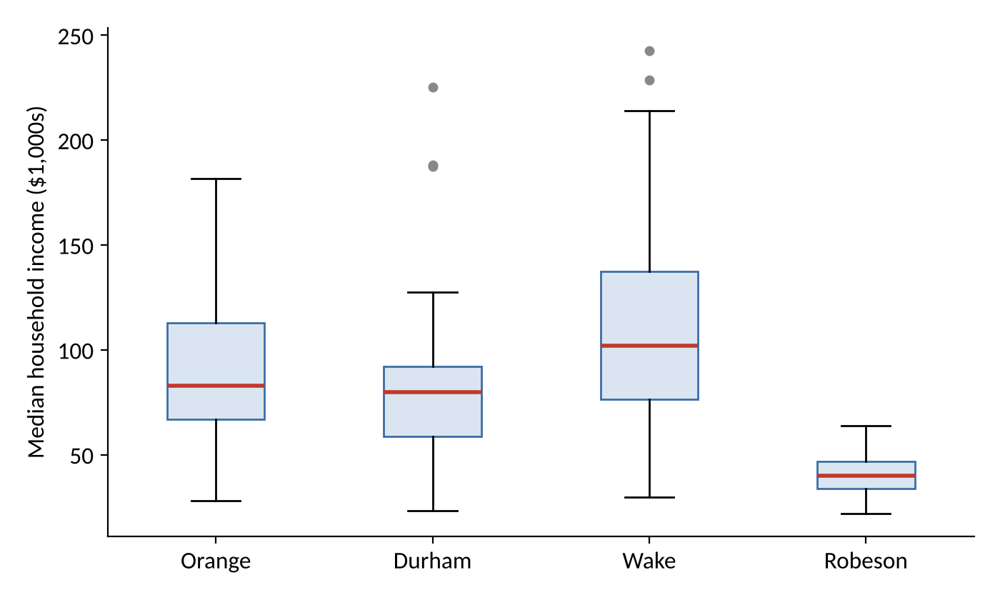
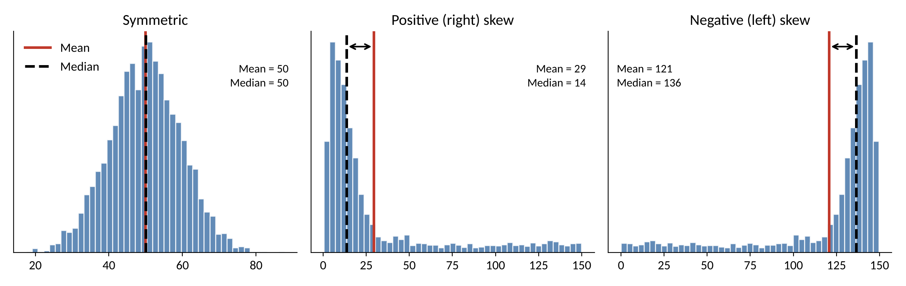
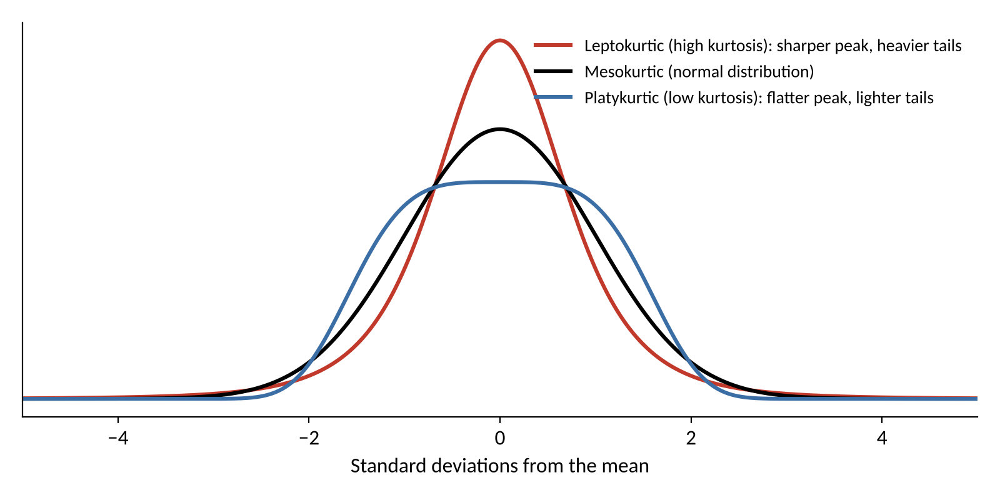

## Overview

**Descriptive statistics** summarize the main characteristics of a dataset using a small number of values, which allows us to understand what a variable looks like without looking at every single observation. Descriptive statistics are also the first step of almost any analysis, since they help us find errors, outliers, and patterns that will shape which methods are appropriate later on.

This chapter introduces levels of measurement, measures of central tendency, measures of dispersion, and measures of shape. It ends with a note on how aggregation affects descriptive statistics for spatial data.

## Levels of Measurement

The first thing to know about a variable is how it is measured. The level of measurement determines which descriptive statistics (and later, which statistical tests) can be used. There are four levels of measurement:

- **Nominal:** Values are categories with no inherent order. Examples include land cover class (forest, water, developed), county name, or primary mode of transportation to work. Numbers can be used as labels (for instance, NLCD class 41 is deciduous forest), but they do not mean anything mathematically.
- **Ordinal:** Values are categories that have a meaningful order, but the distance between categories is not known or not consistent. Examples include a hurricane category (1 to 5), a survey response (strongly disagree to strongly agree), or a road classification (local, collector, arterial, highway).
- **Interval:** Values are ordered and the distance between values is meaningful, but there is no true zero. Temperature in Fahrenheit or Celsius is the classic example: 80°F is 40 degrees warmer than 40°F, but it is not "twice as hot", because 0°F does not mean an absence of temperature.
- **Ratio:** Values are ordered, the distance between values is meaningful, and there is a true zero. Examples include median household income, population, rainfall, and distance to the nearest hospital. Ratio data allow all mathematical operations, so it is meaningful to say that one county has twice the population of another.

In practice, interval and ratio variables are often grouped together as **continuous** (or quantitative) variables, and nominal and ordinal variables are grouped together as **categorical** (or qualitative) variables. Data can also be converted from a higher level of measurement to a lower one. For example, median household income (ratio) could be converted into income categories (ordinal). This often makes data easier to communicate, but it always loses information.

## Measures of Central Tendency

Measures of central tendency describe the "typical" value of a variable. The three most common are the mean, the median, and the mode.

### Mean

The **mean** is the arithmetic average: the sum of all values divided by the number of observations.

$$\bar{x} = \frac{\sum_{i=1}^{n} x_i}{n}$$

where:

- $\bar{x}$ = sample mean
- $x_i$ = value of observation $i$
- $n$ = number of observations

The mean uses every value in the dataset, which makes it the basis for many of the statistical methods we will use later in this course. However, it is sensitive to extreme values. A single census tract with a very high median home value can pull the mean of all tracts in a county upward.

### Median

The **median** is the middle value when all observations are sorted from lowest to highest. If there is an even number of observations, the median is the average of the two middle values. Because the median only depends on the order of the values, it is not affected by extreme values. This is why income and home values are usually reported as medians (for instance, the Census Bureau reports *median* household income).

### Mode

The **mode** is the most frequently occurring value. The mode is the only measure of central tendency that can be used for nominal data, for instance, the most common land cover class in a county. For continuous data, the mode is less useful, given that most values will only occur once.

### Which Measure to Use

The appropriate measure of central tendency depends on the level of measurement and the shape of the distribution:

- Nominal data: mode
- Ordinal data: median (or mode)
- Interval and ratio data: mean if the distribution is roughly symmetric, median if the distribution is skewed or has outliers

Comparing the mean and median is also a quick way to learn about the shape of the data. If the mean is much larger than the median, the distribution likely has a long tail of high values.

## Measures of Dispersion

Two variables can have the same mean but look very different. Measures of dispersion describe how spread out the values are around the center.

### Range and Interquartile Range

The **range** is the difference between the maximum and minimum values. It is easy to calculate, but it only uses two observations, which means it is very sensitive to outliers.

The **interquartile range (IQR)** is the difference between the 75th percentile (third quartile, Q3) and the 25th percentile (first quartile, Q1). The IQR describes the spread of the middle 50% of the data, which makes it resistant to outliers. The IQR is the spread measure that pairs with the median, and it is what is shown by the box in a boxplot.

{fig-alt="Boxplots of census tract median household income in Orange, Durham, Wake, and Robeson counties"}

### Variance and Standard Deviation

The **variance** measures the average squared distance of each observation from the mean:

$$s^2 = \frac{\sum_{i=1}^{n} (x_i - \bar{x})^2}{n - 1}$$

The **standard deviation** is the square root of the variance:

$$s = \sqrt{s^2}$$

where:

- $s^2$ = sample variance
- $s$ = sample standard deviation
- $x_i$ = value of observation $i$
- $\bar{x}$ = sample mean
- $n$ = number of observations

The differences from the mean are squared so that positive and negative differences do not cancel each other out. Taking the square root returns the standard deviation to the original units of the variable, which makes it much easier to interpret than the variance. For example, a standard deviation of 12,000 dollars in median household income means that tract incomes typically fall about 12,000 dollars from the mean. We divide by n − 1 rather than n when calculating the sample variance because a sample tends to slightly underestimate the variability of the full population.

The standard deviation pairs with the mean, so it shares the same sensitivity to outliers.

### Coefficient of Variation

The standard deviation is in the units of the variable, which makes it difficult to compare the spread of variables that are measured on different scales. The **coefficient of variation (CV)** divides the standard deviation by the mean:

$$CV = \frac{s}{\bar{x}} \times 100$$

The CV expresses variability as a percentage of the mean. For example, we could use the CV to compare whether annual rainfall is more variable in the mountains or on the coast of North Carolina, even though the two regions have very different average rainfall.

## Measures of Shape

The shape of a distribution describes how the values are arranged around the center. Histograms are the most common way to look at the shape of a continuous variable.

{fig-alt="Histograms of a symmetric, a right-skewed, and a left-skewed distribution with the mean and median marked"}

### Skewness

**Skewness** describes whether a distribution is symmetric or has a longer tail on one side.

- **Symmetric:** The left and right sides of the distribution are mirror images. The mean and median are approximately equal.
- **Positive (right) skew:** The distribution has a long tail of high values. The mean is larger than the median. Many social and economic variables are positively skewed, such as income, home value, and population density, since most places have moderate values and a few places have very high values.
- **Negative (left) skew:** The distribution has a long tail of low values. The mean is smaller than the median. An example would be life expectancy, where most values are high and a smaller number of places have much lower values.

A skewness value of 0 indicates a symmetric distribution, positive values indicate positive skew, and negative values indicate negative skew.

### Kurtosis

**Kurtosis** describes how much of the data is in the tails of the distribution compared to a normal distribution. A distribution with high kurtosis has heavier tails (more extreme values) than a normal distribution, while a distribution with low kurtosis has lighter tails. Kurtosis is less commonly reported than skewness, but it is useful for identifying datasets that have more extreme values than we would expect.

{fig-alt="Three distributions with the same mean and standard deviation: leptokurtic, mesokurtic, and platykurtic"}

### Why Shape Matters

Many of the statistical methods we will use in this course assume that a variable (or the residuals of a model) is approximately normally distributed (see the Probability reading). Looking at the shape of a variable before running an analysis helps us know whether those assumptions are reasonable. When a variable is strongly skewed, it is common to apply a **transformation**, such as taking the natural log of income or population density, to make the distribution more symmetric.

## Describing Spatial Data: A Note on Aggregation

All of the descriptive statistics in this chapter can be calculated for spatial data, but for areal data the results depend on the spatial units used. As discussed in the Introduction to Space reading, this is the **Modifiable Areal Unit Problem (MAUP)**. The table from that reading shows the scale effect: the mean percent poverty across North Carolina is similar for zip codes (25.33) and counties (26.46), but the standard deviation is about twice as large for zip codes (13.82) as for counties (6.58), and the range shrinks from 0–100 to 12.34–40.83.

This happens because aggregating data to larger units averages out local variation. Measures of central tendency are often relatively stable across scales, but measures of dispersion and the minimum and maximum values are not. When reporting descriptive statistics for areal data, you should always state the spatial unit, and when possible, compare results across more than one unit.

Another issue to be aware of is the difference between describing **places** and describing **people**. The mean of a variable across census tracts gives each tract equal weight, regardless of how many people live there. A rural tract with 1,500 residents counts the same as an urban tract with 8,000 residents. If the goal is to describe the typical *person*, a population-weighted mean is more appropriate.
