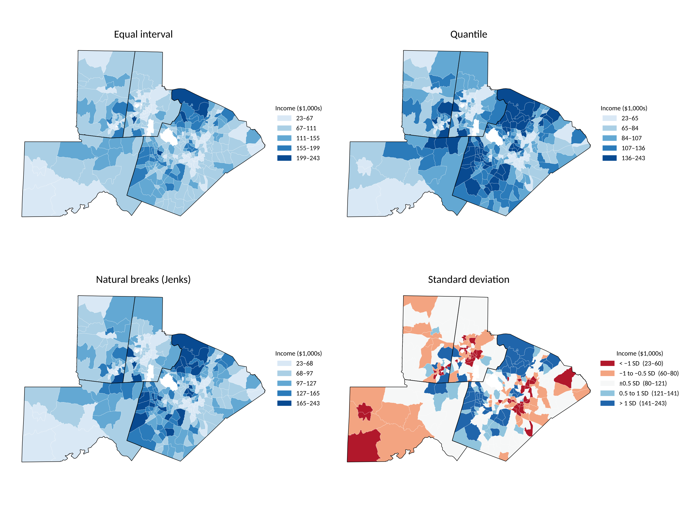
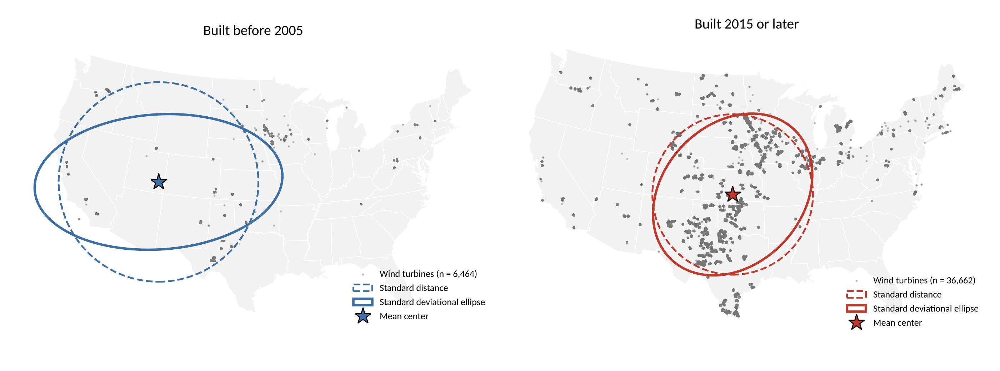
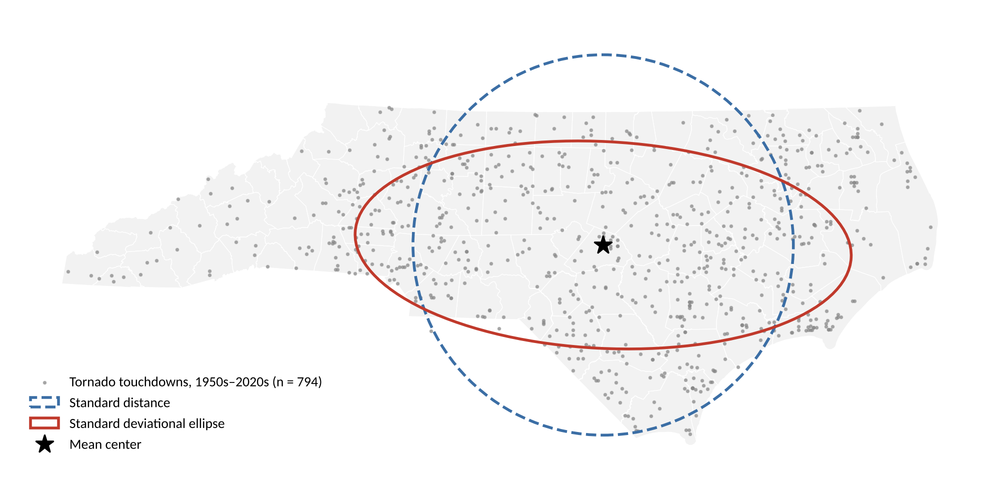

## Overview

The descriptive statistics in the Describing Data reading summarize the *attributes* of a dataset, but they ignore location. Two datasets could have exactly the same mean and standard deviation and still have completely different spatial patterns. Describing spatial data requires two additional sets of tools: maps, which allow us to visualize how values are distributed across space, and spatial descriptive statistics (sometimes called **centrography**), which summarize the center and spread of a set of locations.

This chapter introduces data classification for choropleth maps, some of the common pitfalls with making maps, and three spatial descriptive statistics: the mean center, standard distance, and the standard deviational ellipse.

## Mapping Areal Data

The most common way to map areal data is a **choropleth map**, where each areal unit (for instance, a county or census tract) is shaded based on its value. Because there are usually too many unique values to give each one its own color, values are grouped into a small number of classes. How those classes are defined is called **data classification**, and it can have a large impact on what the map shows.

### Classification Methods

There are several common classification methods:

- **Equal interval:** The range of the data is divided into classes of equal width. For example, percent poverty from 0 to 40 split into four classes would have breaks at 10, 20, and 30. Equal interval is easy to understand, but if the data are skewed, most observations may fall into one or two classes.
- **Quantile:** Each class contains the same number of observations. With five classes (quintiles), each class contains 20% of the areal units. Quantile maps are useful for showing relative rank, but they can put very similar values into different classes, or very different values into the same class, depending on where the breaks fall.
- **Natural breaks (Jenks):** Breaks are placed where there are large gaps in the data, so that values within a class are as similar as possible and values in different classes are as different as possible. Natural breaks work well for showing the structure of a particular dataset, but the breaks are specific to that dataset, which makes it difficult to compare maps of different variables or years.
- **Standard deviation:** Classes are defined by how many standard deviations each value is from the mean (for instance, more than 1 standard deviation below the mean, within 1 standard deviation, more than 1 standard deviation above the mean). This works best for data that are approximately normally distributed and is usually paired with a diverging color scheme centered on the mean.
- **Manual (user-defined):** Breaks are chosen by the map maker. This is useful when there are meaningful thresholds, such as the federal poverty line, an EPA air quality standard, or round numbers that are easy for the reader to interpret.

{fig-alt="Four choropleth maps of Triangle census tract median household income using equal interval, quantile, natural breaks, and standard deviation classification"}

The number of classes also matters. Too few classes hide variation in the data, while too many classes make it difficult for the reader to tell colors apart. In general, between four and seven classes is a reasonable range for a choropleth map.

There is no single "correct" classification method. The choice should depend on the distribution of the data (look at a histogram first!) and the purpose of the map. It is good practice to map the data using more than one method to see how sensitive the pattern is to the classification.

### Common Mapping Pitfalls

Every map is a simplification, and the choices made when creating a map shape what the reader sees. Mark Monmonier's book *How to Lie with Maps* (1991) is a well-known discussion of this. Some of the most common issues include:

- **Classification choices:** As shown above, the same data can produce maps that look very different depending on the classification method and the number of classes. A map maker can make a pattern look more or less extreme just by changing the breaks.
- **Counts vs. rates:** Choropleth maps should almost always show rates, percentages, or densities rather than raw counts. A map of the total number of people in poverty by county mostly shows where people live (Wake and Mecklenburg will always stand out). Mapping the *percent* of people in poverty **normalizes** the data by population, which allows areas of different sizes to be compared.
- **Large-area bias:** On a choropleth map, large areal units draw more visual attention than small ones, even if they contain fewer people. In North Carolina, large, rural counties in the east and west can visually dominate a map, while small, densely populated counties and urban census tracts are hard to see.
- **Color:** Sequential color schemes (light to dark) should be used for data that go from low to high, and diverging color schemes (two colors with a neutral middle) should be used for data with a meaningful midpoint, like change over time or deviation from the mean. Using a diverging scheme for data without a midpoint, or a color scheme with no clear order, can confuse readers.
- **Small numbers:** Rates calculated for areas with small populations can be very unstable. A rural census tract with a few hundred residents could have a very high or very low rate of a rare disease simply by chance, and these extreme values will stand out on a map.
- **Uncertainty:** Data like the American Community Survey are estimates with margins of error, and some tract-level estimates are very uncertain. Most maps show the estimate without any indication of this uncertainty.

The MAUP (see Introduction to Space) also applies here: the same data aggregated to different units, or to units with different boundaries, can produce very different maps.

## Spatial Descriptive Statistics

Spatial descriptive statistics summarize the locations of a set of features, most often points. These measures are the spatial versions of the mean and standard deviation, and they are useful for describing where a set of events is centered, how dispersed the events are, and whether they are oriented in a particular direction. They are also useful for comparing distributions, for instance, the locations of a disease outbreak in two different years, or the locations of two different types of businesses.

### Mean Center

The **mean center** is the average x coordinate and the average y coordinate of all features in the dataset:

$$
\bar{X} = \frac{\sum_{i=1}^{n} x_i}{n}, \quad \bar{Y} = \frac{\sum_{i=1}^{n} y_i}{n}
$$

where:

- xᵢ, yᵢ = coordinates of feature i
- n = number of features

The mean center can also be **weighted** by an attribute. For example, the U.S. Census Bureau calculates the mean center of the U.S. population every ten years by weighting each location by the number of people who live there. The mean center of population has moved steadily west and south since the first census in 1790, which reflects westward expansion and, more recently, population growth in the South and West.

Like the regular mean, the mean center is sensitive to outliers. A few points far from the rest of the data can pull the mean center toward them, and the mean center might not fall on or near any actual feature. The **median center**, the location that minimizes the total distance to all features, is less sensitive to outliers.

Because the mean center is calculated from coordinates, the data should be in a **projected coordinate system** (for instance, NC State Plane) rather than latitude and longitude, so that distances are measured consistently.

### Standard Distance

The **standard distance** measures how dispersed features are around the mean center. It is the spatial equivalent of the standard deviation:

$$
SD = \sqrt{\frac{\sum_{i=1}^{n} (x_i - \bar{X})^2}{n} + \frac{\sum_{i=1}^{n} (y_i - \bar{Y})^2}{n}}
$$

The standard distance is measured in the same units as the coordinates (for instance, meters or feet) and is usually shown as a circle around the mean center. A larger standard distance means that features are more spread out, and a smaller standard distance means that features are more concentrated around the center. For instance, we could compare the standard distance of car crashes in Chapel Hill and in Raleigh to see which set of crashes is more spatially concentrated. Like the standard deviation, the standard distance can also be weighted by an attribute.

### Standard Deviational Ellipse

The standard distance assumes that features are spread out equally in all directions. In reality, many spatial distributions are stretched in one direction. For example, development might follow a highway corridor, or flooding might follow a river valley. The **standard deviational ellipse** measures dispersion separately along two perpendicular axes, which allows it to capture the **directional trend** of the data.

The ellipse has three components:

- **Center:** the mean center of the features
- **Orientation (rotation):** the angle of the long axis, which shows the direction in which the features are most spread out
- **Major and minor axes:** the standard deviation along the long axis and the short axis, which describe how spread out the features are in each direction

If the major and minor axes are similar in length, the distribution is roughly circular and has no strong directional trend. If the major axis is much longer than the minor axis, the features are elongated in one direction.

The map below compares wind turbines in the contiguous United States that were built before 2005 with those built in 2015 or later. For the older turbines, the mean center falls in southern Utah, even though there are almost no turbines there. This is because the turbines were split between California, the Pacific Northwest, and the Great Plains, and the mean center falls in between them. The standard distance is large, and the ellipse is stretched east to west across the groups. For the newer turbines, the mean center has moved about 1,000 km east to central Kansas, the standard distance is smaller, and the ellipse runs from northeast to southwest, following the band of wind development through the Great Plains from Texas to Iowa and Minnesota.

{fig-alt="Two maps of wind turbines in the contiguous United States, built before 2005 and built 2015 or later, each with the mean center, standard distance, and standard deviational ellipse"}

### A Caution: The Shape of the Study Area

The mean center, standard distance, and standard deviational ellipse are calculated from wherever the features happen to be, and features can only occur inside the study area. This means that the shape of the study area can drive the results. North Carolina is about 500 miles wide from east to west, but less than 200 miles from north to south. The map below shows tornado touchdowns in North Carolina. The standard deviational ellipse is stretched east to west, but this mostly reflects the shape of the state, not a directional trend in where tornadoes occur. The standard distance circle also extends well outside the state. Before interpreting the orientation of an ellipse, it is important to ask whether the features could have been spread out in every direction, or whether the boundary of the study area limits where they can occur.

{fig-alt="North Carolina tornado touchdown points with the mean center, standard distance circle, and standard deviational ellipse"}

Spatial descriptive statistics are useful for describing and comparing spatial distributions, but they do not tell us *why* features are arranged the way they are, or whether the pattern is different from what we would expect by chance. To answer those questions, we need the methods in the Point Pattern Analysis reading.

## Reading Quiz {.unnumbered}

::: {.reading-quiz data-quiz="describing-spatial-data"}
:::
