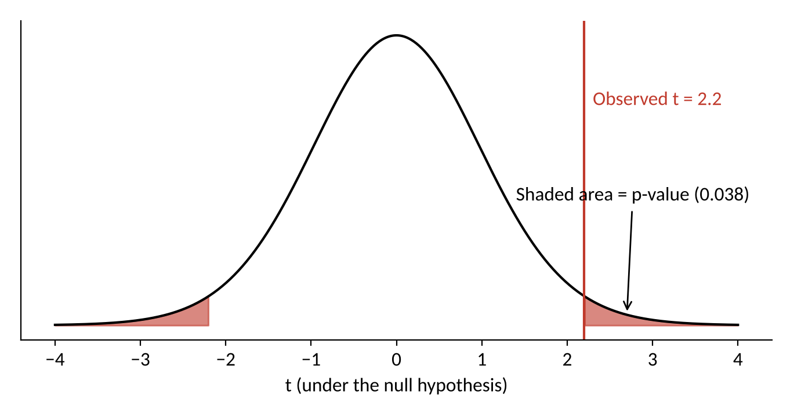

## Overview

Confidence intervals (see the Sampling and Estimation reading) give us a range of plausible values for a population parameter. **Hypothesis testing** uses the same ideas to answer a slightly different question: is the pattern we see in our sample strong enough that it is unlikely to have occurred by random chance alone? For example, is average PM2.5 higher near major highways than in other parts of Durham? Do median home values differ between two counties? Is commute mode related to whether someone lives in an urban or rural area?

This chapter introduces the logic of hypothesis testing, p-values, the two types of errors, and three common families of tests: t-tests, chi-square tests, and ANOVA. It ends with the difference between statistical significance and practical importance.

## The Logic of Hypothesis Testing

Every hypothesis test starts with two competing statements about the population:

- **Null hypothesis (H₀):** There is no difference, no relationship, or no effect. Any pattern in the sample is due to random sampling variability.
- **Alternative hypothesis (H₁ or Hₐ):** There is a difference, relationship, or effect in the population.

For example, if we wanted to know whether average summer PM2.5 in a city differs from the EPA's annual standard of 9 µg/m³, the hypotheses would be:

- H₀: μ = 9
- H₁: μ ≠ 9

The key idea is that we assume the null hypothesis is true and then ask how likely our sample result would be under that assumption. If the result would be very unlikely, we have evidence against the null hypothesis. Hypothesis testing never proves that the alternative hypothesis is true. We either **reject** the null hypothesis or **fail to reject** it.

An alternative hypothesis can be **two-tailed** (the mean is different from 9, in either direction) or **one-tailed** (the mean is greater than 9, or the mean is less than 9). A one-tailed test should only be used when there is a clear reason, decided before looking at the data, to expect a difference in one direction.

### Steps in a Hypothesis Test

Most hypothesis tests follow the same general steps:

1. State the null and alternative hypotheses
2. Choose a significance level (α), usually 0.05
3. Choose the appropriate test based on the type of data and the question, and check its assumptions
4. Calculate the **test statistic** from the sample data
5. Compare the test statistic to its probability distribution under the null hypothesis to find the p-value
6. Make a decision (reject or fail to reject H₀) and interpret the result in the context of the research question

The test statistic usually measures how far the sample result is from what the null hypothesis expects, in units of standard error. For example, the one-sample t statistic is:

$$
t = \frac{\bar{x} - \mu_0}{s / \sqrt{n}}
$$

where:

- x̄ = sample mean
- μ₀ = population mean under the null hypothesis
- s = sample standard deviation
- n = sample size

## P-Values

The **p-value** is the probability of getting a test statistic at least as extreme as the one we observed, *if the null hypothesis were true*. On a probability distribution, the p-value is the area in the tail (or tails, for a two-tailed test) beyond the observed test statistic.

{fig-alt="A t-distribution with both tails beyond the observed test statistic shaded as the p-value"}

If the p-value is less than the significance level (α), we reject the null hypothesis and describe the result as **statistically significant**. If the p-value is greater than α, we fail to reject the null hypothesis.

The p-value is one of the most misinterpreted values in statistics. It is important to remember what a p-value is **not**:

- It is not the probability that the null hypothesis is true
- It is not the probability that the result occurred by chance
- It does not tell us how large or important the effect is

A p-value of 0.03 means that, if there truly were no difference in the population, we would see a difference at least this large in about 3% of random samples.

## Type I and Type II Errors

Because hypothesis tests are based on samples, we can make the wrong decision even when we follow all of the steps correctly. There are two types of error:

| Decision | H₀ is true | H₀ is false |
| --- | --- | --- |
| **Reject H₀** | Type I error (false positive) | Correct decision |
| **Fail to reject H₀** | Correct decision | Type II error (false negative) |

- **Type I error:** Rejecting the null hypothesis when it is actually true. The probability of a Type I error is equal to the significance level, α. With α = 0.05, we accept a 5% chance of finding a difference that is not really there.
- **Type II error:** Failing to reject the null hypothesis when it is actually false. The probability of a Type II error is called β. The **power** of a test (1 − β) is the probability of correctly detecting a real effect.

There is a trade-off between the two. Lowering α (for instance, to 0.01) makes a Type I error less likely, but it makes a Type II error more likely. The main way to reduce both types of error at the same time is to increase the sample size.

Which error is worse depends on the context. If we are testing whether well water near a landfill is contaminated, a Type II error (concluding there is no contamination when there is) could have serious health consequences, so we might accept a higher chance of a Type I error.

Type I errors also add up when many tests are run. If we run 20 independent tests at α = 0.05, we would expect about one of them to be significant just by chance. This is important to keep in mind for local spatial statistics like LISA (see the Spatial Modeling reading), where a test is run for every areal unit.

## Choosing a Test

The appropriate test depends on the type of data and the question being asked. The tests below are **parametric** tests, which assume that the data (or the sampling distribution) follow a particular probability distribution. Each has a **non-parametric** alternative that can be used when those assumptions are not met.

### T-Tests

T-tests compare means and use the t-distribution. There are three types:

- **One-sample t-test:** Compares a sample mean to a known or hypothesized value. For example, does the average PM2.5 across a set of monitors differ from the EPA standard?
- **Two-sample (independent) t-test:** Compares the means of two independent groups. For example, does average PM2.5 differ between monitors within 500 meters of a major highway and monitors farther away? Welch's t-test is a version of the two-sample t-test that does not assume the two groups have equal variances, and it is the default in R.
- **Paired t-test:** Compares two measurements taken on the same units. For example, did PM2.5 at the same set of monitors change between 2019 and 2020? Because each monitor is compared to itself, the paired t-test removes differences between locations.

T-tests assume that the observations are independent and that the data are approximately normally distributed (or that the sample size is large enough for the Central Limit Theorem to apply). The non-parametric alternatives are the Wilcoxon signed-rank test (for one-sample and paired tests) and the Mann-Whitney U test (for two independent samples), which compare medians or ranks rather than means.

### ANOVA

When we want to compare means across more than two groups, running many t-tests increases the chance of a Type I error. **Analysis of variance (ANOVA)** tests whether the means of three or more groups are all equal, using the F-distribution. For example, does median household income differ across the mountain, Piedmont, and coastal plain regions of North Carolina? A significant ANOVA tells us that at least one group mean is different, but not which one. Post-hoc tests (such as Tukey's HSD) are used to identify which groups differ. The non-parametric alternative is the Kruskal-Wallis test.

### Chi-Square Tests

Chi-square tests are used for categorical (nominal or ordinal) data and compare **observed frequencies** to the frequencies we would **expect** under the null hypothesis:

$$
\chi^2 = \sum \frac{(O - E)^2}{E}
$$

where:

- O = observed frequency in each category
- E = expected frequency in each category under the null hypothesis

There are two common types:

- **Chi-square goodness-of-fit test:** Tests whether the frequencies of a single categorical variable match an expected distribution. For example, are tornado touchdowns in North Carolina evenly distributed across the three physiographic regions, relative to their area?
- **Chi-square test of independence:** Tests whether two categorical variables are related, using a contingency table. For example, is primary commute mode (drive alone, carpool, transit, walk/bike) related to whether a household lives in an urban or rural census tract?

Chi-square tests require that the expected frequency in each cell is reasonably large (a common rule of thumb is at least 5). When expected frequencies are small, Fisher's exact test can be used instead.

### A Note on Independence

All of the tests in this chapter assume that observations are independent. As we saw in the Introduction to Space reading, spatial data often violate this assumption because nearby observations tend to be similar. When observations are positively spatially autocorrelated, each observation provides less unique information than the test assumes, which makes standard errors too small and p-values too low. This increases the chance of a Type I error. This is one of the main reasons that we use spatial methods later in the course.

## Statistical Significance vs. Practical Importance

A statistically significant result is not necessarily an important one. Statistical significance depends heavily on sample size. With a very large sample, even a very small difference will produce a small p-value. For example, with data for every census tract in the United States, a difference of 50 dollars in median household income between two groups of tracts could be statistically significant, even though it is not meaningful in any practical sense. On the other hand, with a small sample, a large and meaningful difference might not be statistically significant.

For this reason, it is important to report the **effect size**, which describes the magnitude of the difference or relationship, alongside the p-value. The simplest effect size is the difference itself, in the original units (for instance, PM2.5 was 1.8 µg/m³ higher near highways). Standardized effect sizes, like Cohen's d for t-tests or Cramér's V for chi-square tests, allow effects to be compared across studies. Reporting a confidence interval for the difference is also useful, since it shows both the size of the effect and the uncertainty around it.

When interpreting results, the question should not only be "is this significant?" but also "is this difference large enough to matter for the people or places being studied?"

## Reading Quiz {.unnumbered}

::: {.reading-quiz data-quiz="hypothesis-testing"}
:::
