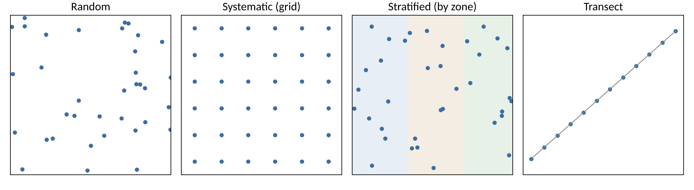
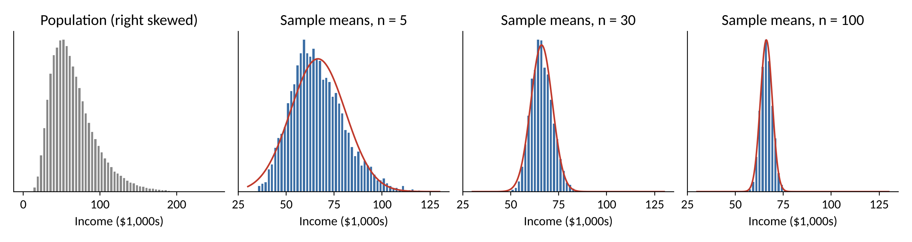
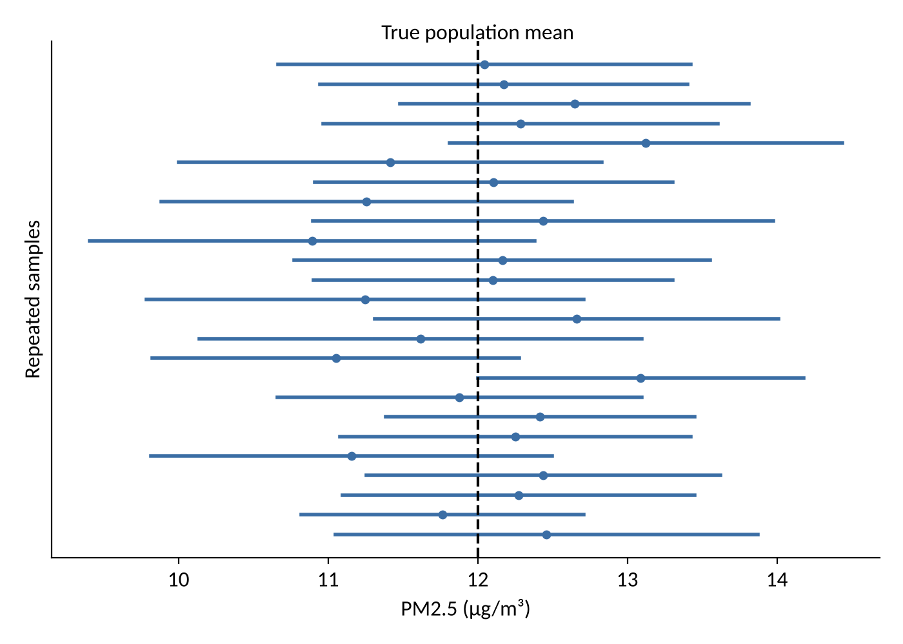

## Overview

In most research, it is not possible to measure every member of a population. We cannot measure air quality at every location in North Carolina, survey every household in Durham, or count every tree in the Duke Forest. Instead, we collect a **sample** and use it to make inferences about the larger **population**. As introduced in the Probability reading, this introduces sampling uncertainty: a different sample would produce a somewhat different result.

This chapter introduces sampling designs (including spatial sampling designs), the sampling distribution and the Central Limit Theorem, and confidence intervals, which allow us to quantify the uncertainty in an estimate.

## Populations and Samples

A **population** is the full set of individuals, objects, or locations that we are interested in. A **sample** is a subset of the population that we actually observe. Values that describe a population are called **parameters**, and values that describe a sample are called **statistics**. We use sample statistics to estimate population parameters. By convention, population parameters are written using Greek letters and sample statistics are written using Latin letters:

| Measure | Population parameter | Sample statistic |
| --- | --- | --- |
| Mean | μ | x̄ |
| Standard deviation | σ | s |
| Proportion | p | p̂ |

For an estimate to be useful, the sample should be **representative** of the population. Two types of error can make a sample statistic differ from the population parameter:

- **Sampling error:** Random differences between the sample and the population that occur simply because we observed a subset. Sampling error cannot be eliminated, but it gets smaller as the sample size increases, and it can be quantified using probability.
- **Bias:** Systematic differences between the sample and the population caused by how the sample was collected. For example, a survey about public transit conducted only at bus stops will overestimate transit use. Unlike sampling error, bias does not get smaller as the sample size increases, and it cannot be fixed with statistics.

## Sampling Designs

The way a sample is selected is called the **sampling design**. In a **probability sample**, every member of the population has a known, nonzero chance of being selected. Probability samples are required for the statistical inference methods in this course. In a **non-probability sample**, such as a convenience sample (surveying whoever is easiest to reach) or a volunteer sample, there is no way to know how representative the sample is.

The common probability sampling designs are:

- **Simple random sampling:** Every member of the population has an equal chance of being selected, and every selection is independent of the others. For instance, randomly selecting 200 addresses from a list of all addresses in Chapel Hill.
- **Systematic sampling:** Members are selected at a regular interval, for instance, every 10th address on a list. Systematic sampling is easy to carry out, but it can be biased if there is a pattern in the list that lines up with the sampling interval.
- **Stratified sampling:** The population is divided into groups (strata) that share a characteristic, and a random sample is taken within each group. For example, a statewide survey might sample separately within urban, suburban, and rural counties to make sure each is represented. Stratified sampling is useful when the groups are different from one another and we want precise estimates for each group.
- **Cluster sampling:** The population is divided into groups (clusters), a random set of clusters is selected, and every member (or a random sample of members) within the selected clusters is observed. For example, randomly selecting 20 census block groups and surveying households within them. Cluster sampling is often cheaper, since data collection is concentrated in fewer places, but it usually produces less precise estimates because members of the same cluster tend to be similar.

### Spatial Sampling Designs

When the population is a continuous surface (like elevation, soil moisture, or air quality), we sample **locations**. The same designs apply, but they are carried out in space:

- **Random spatial sampling:** Sample locations are randomly placed across the study region. Random sampling can, by chance, leave large gaps or create clusters of sample points.
- **Systematic (grid) sampling:** Sample locations are placed on a regular grid. Grid sampling gives even coverage of the study area, which is useful for interpolation (see the Continuous Surfaces reading), but it can miss patterns that occur at a smaller scale than the grid spacing or that line up with the grid.
- **Stratified spatial sampling:** The study region is divided into zones (for instance, land cover types or ecoregions), and sample locations are randomly placed within each zone. This ensures that every zone is represented.
- **Transect sampling:** Samples are taken at intervals along a line, for instance, from the coast inland, or across an urban to rural gradient. Transects are useful for studying how a variable changes along a known gradient.

{fig-alt="Four panels showing random, systematic grid, stratified, and transect sample locations"}

Because of spatial dependence (see Introduction to Space), sample points located close together tend to have similar values, which means they provide less independent information than sample points that are farther apart. This is one reason that systematic and stratified designs are often preferred for spatial sampling.

In practice, a lot of spatial data does not come from a planned sampling design. Air quality monitors, for example, are placed where agencies or individuals decide to put them. The EPA's regulatory PM2.5 monitors in North Carolina are concentrated in and around larger cities, and low-cost sensor networks (like PurpleAir) tend to be more common in wealthier neighborhoods. Neither network is a random sample of locations, which can bias estimates of air quality across the state.

## The Sampling Distribution

If we took one random sample of 50 PM2.5 readings and calculated the mean, we would get one estimate of the population mean. If we took another random sample of 50, we would get a slightly different estimate. If we repeated this many times, we could plot all of the sample means as a histogram. This distribution of a statistic across repeated samples is called the **sampling distribution**.

The sampling distribution is a theoretical idea, since in real research we usually only have one sample. However, it is the foundation of statistical inference, because it tells us how much a sample statistic is likely to vary from the true population value.

The standard deviation of the sampling distribution is called the **standard error (SE)**. For the sample mean:

$$
SE = \frac{\sigma}{\sqrt{n}}
$$

where:

- σ = population standard deviation (in practice, estimated using the sample standard deviation, s)
- n = sample size

The standard error is important to distinguish from the standard deviation. The standard deviation describes how much individual observations vary. The standard error describes how much the sample *mean* varies from sample to sample. Because n is in the denominator, the standard error gets smaller as the sample size increases: larger samples produce more precise estimates. However, because of the square root, to cut the standard error in half, the sample size must be four times as large.

### The Central Limit Theorem

The **Central Limit Theorem (CLT)** states that, for a sufficiently large sample size, the sampling distribution of the sample mean will be approximately normally distributed, *regardless of the shape of the population distribution*. The sampling distribution will be centered on the population mean (μ), with a standard deviation equal to the standard error.

This is a very useful result. Many geographic variables, like income or population density, are strongly skewed (see Describing Data). The CLT tells us that even if the population is skewed, the means of repeated samples will still follow a normal distribution, which means we can use the normal distribution to calculate probabilities about the sample mean. A common rule of thumb is that a sample size of 30 or more is large enough for the CLT to apply, although strongly skewed populations may require larger samples.

{fig-alt="A right-skewed population distribution and the sampling distributions of the mean for n = 5, 30, and 100"}

## Confidence Intervals

A single sample statistic is called a **point estimate**. Because of sampling error, we know that the point estimate is almost certainly not exactly equal to the population parameter. A **confidence interval** provides a range of plausible values for the population parameter, based on the point estimate and the standard error.

The general form of a confidence interval is:

$$
\text{point estimate} \pm (\text{critical value} \times SE)
$$

The critical value times the standard error is called the **margin of error**. The critical value comes from a probability distribution and depends on the **confidence level**, most commonly 95%.

### Confidence Intervals for a Mean

If the population standard deviation (σ) is known, the confidence interval uses the z-distribution (the standard normal distribution):

$$
\bar{x} \pm z^* \frac{\sigma}{\sqrt{n}}
$$

For a 95% confidence interval, z\* = 1.96, since 95% of the area under the standard normal curve falls within 1.96 standard deviations of the mean.

In practice, we almost never know σ, so we estimate it using the sample standard deviation (s). This adds additional uncertainty, so we use the **t-distribution** instead of the z-distribution:

$$
\bar{x} \pm t^* \frac{s}{\sqrt{n}}
$$

The t-distribution is bell-shaped like the normal distribution but has heavier tails, which produces a wider interval. The shape of the t-distribution depends on the **degrees of freedom** (n − 1). As the sample size increases, the t-distribution gets closer and closer to the normal distribution.

### Confidence Intervals for a Proportion

For a proportion, such as the proportion of households with solar panels from the Probability reading, the standard error is:

$$
SE = \sqrt{\frac{\hat{p}(1 - \hat{p})}{n}}
$$

and the confidence interval is:

$$
\hat{p} \pm z^* \sqrt{\frac{\hat{p}(1 - \hat{p})}{n}}
$$

For example, if 36 out of 300 randomly sampled households in a community have solar panels, p̂ = 0.12, the standard error is about 0.019, and the 95% confidence interval is approximately 0.12 ± 0.037, or 8.3% to 15.7%.

### Interpreting Confidence Intervals

A 95% confidence interval means that if we repeated the sampling process many times and calculated a confidence interval from each sample, about 95% of those intervals would contain the true population parameter. It does **not** mean that there is a 95% probability that the population parameter is in this particular interval. The population parameter is a fixed value; it is either in the interval or it is not. The 95% describes how reliable the *method* is.

{fig-alt="25 confidence intervals from repeated samples around the true population mean, with intervals that miss highlighted in red"}

The width of a confidence interval depends on three things:

- **Confidence level:** A higher confidence level (e.g., 99% instead of 95%) requires a larger critical value, which produces a wider interval.
- **Variability:** More variability in the data (a larger s) produces a wider interval.
- **Sample size:** A larger sample produces a smaller standard error, which produces a narrower interval.

### Margins of Error in Census Data

One place you will see confidence intervals regularly is the American Community Survey (ACS). Unlike the decennial census, the ACS is a sample survey, so every ACS estimate comes with a **margin of error (MOE)**. The Census Bureau reports ACS margins of error at the 90% confidence level. For small areas like census tracts and block groups, the sample sizes are small and the margins of error can be very large compared to the estimate. When comparing two tracts, it is important to check whether their confidence intervals overlap before concluding that one is actually higher than the other.

## Reading Quiz {.unnumbered}

::: {.reading-quiz data-quiz="sampling-and-estimation"}
:::
